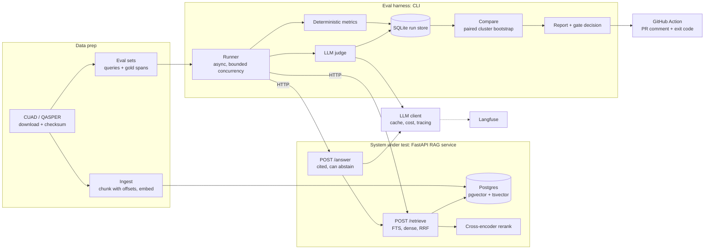

# Calibrated RAG Evaluation Lab

An open-source harness that answers the question every team changing a RAG system has: **did this change make retrieval or answers better, by how much, and can I trust the judge that says so?**

> **Status (2026-10-28): Phase 2 of 9 done, Phase 3 in progress; four provisional dev results, no final results yet.** The Python project skeleton, the Postgres and pgvector stack, settings, JSON logging, the approved [evaluation spec](docs/eval-spec.md), CUAD ingestion (chunking and local embeddings), the retrieval service with Postgres full-text search, dense search, their fusion and a cross-encoder rerank of the fusion (`/retrieve`), the retrieval metrics and a minimal `ragcalibrate run` exist and pass lint, type checks, unit and integration tests. The structure-aware chunker, the run store, the statistics and gate, answering and the LLM judge are still to be written. Every result is `TBD` until it appears in [docs/results.md](docs/results.md) with a command that regenerates it; the rows there so far are provisional dev numbers for full-text, dense, hybrid and reranked retrieval, without confidence intervals yet. Sections 3 onward describe what the system is designed to do and why. Progress is tracked in [docs/project-plan.md](docs/project-plan.md).

## Contents

1. [What it does](#1-what-it-does)
2. [How the repo is organised](#2-how-the-repo-is-organised)
3. [Architecture](#3-architecture)
4. [The data flow, step by step](#4-the-data-flow-step-by-step)
5. [The statistics you need to be able to explain](#5-the-statistics-you-need-to-be-able-to-explain)
6. [Decisions: why this and not that](#6-decisions-why-this-and-not-that)
7. [Using it on your own RAG system](#7-using-it-on-your-own-rag-system)
8. [Limitations and threats to validity](#8-limitations-and-threats-to-validity)
9. [Questions you should be ready to answer](#9-questions-you-should-be-ready-to-answer)
10. [Planned interface, stack, licenses](#10-planned-interface-stack-licenses)

---

## 1. What it does

Existing RAG eval tools compute scores. This one tells you **how much to trust a score, and whether the difference between two scores is real.** It does three things:

1. **Measures retrieval against span-level ground truth.** "Relevant" means the retrieved text overlaps the characters a lawyer marked in a contract (CUAD), not "an LLM thought it was relevant".
2. **Calibrates its LLM judge.** Judge verdicts are compared with gold labels and reported as Cohen's κ with confidence intervals, alongside measured biases (position, verbosity, citation trust). The judge ships with a known error rate.
3. **Gates pull requests on statistically honest comparisons.** The gate uses a paired bootstrap confidence interval, clustered by document, on the metric difference. It ships with a measured false-alarm rate (on changes that do nothing) and a measured detection power (on seeded regressions).

The system under test is a small but real hybrid-retrieval RAG service (FastAPI, PostgreSQL with pgvector and full-text search, a cross-encoder reranker). The harness reaches it **only over HTTP**, so in principle it can evaluate any service that speaks the same small contract (see [section 7](#7-using-it-on-your-own-rag-system) for how true that is).

**Why this is worth building.** Teams change chunking, embedding models, prompts and rerankers without knowing whether quality dropped. When they do measure, they often use an LLM-judge score nobody validated, compared as point estimates over a few dozen queries. A CI gate built on that flakes, and flaky gates get ignored or deleted. The skill on display is not "I built a RAG chatbot"; it is "I can say whether a change made it better, by how much, with what error bars."

---

## 2. How the repo is organised

| Path | What it is |
| --- | --- |
| `README.md` | This file: what the project is and how it works |
| [docs/project-plan.md](docs/project-plan.md) | Index and status board for agents and contributors. **Start here to work on the project** |
| [docs/design/project-design.md](docs/design/project-design.md) | The full design: rationale, methodology, schedule, risks. Cited as "Design §N" |
| [docs/phases/](docs/phases/) | Actionable steps per phase, with verification and completion notes |
| [docs/findings/](docs/findings/) | Things learned along the way that affect the project |
| [docs/adr/](docs/adr/) | Architecture decision records, written when each decision is made |
| [docs/results.md](docs/results.md) | The ledger of measured headline numbers and the commands that produce them |
| [docs/eval-spec.md](docs/eval-spec.md) | Exactly what each metric, split and the gate mean (approved) |
| [DATA_LICENSES.md](DATA_LICENSES.md) | Licenses and attribution for the datasets |
| `scripts/`, `Makefile`, `docker-compose.yml` | Dataset download and measurement scripts; the one-command entry points; the Postgres and pgvector stack |
| `.claude/skills/master-code-skill/` | Coding rules for AI agents working in this repo |

Code layout. `corpora`, `ingest`, `service` (`/retrieve` with dense search so far) and the retrieval metrics in `harness` have code; `llm`, `stats` and `report` are empty placeholders until their phase:

```text
src/ragcalibrate/
├── contract.py  the HTTP request/response models, the only code harness and service share
├── corpora/   CUAD and QASPER adapters: documents, queries, gold spans
├── ingest/    versioned chunkers, embedding, bulk load into Postgres
├── service/   FastAPI app, the system under test: /retrieve, /answer
├── llm/       provider interface, content-addressed cache, cost, tracing
├── harness/   runner, HTTP adapter, metrics, judge, SQLite run store, CLI
├── stats/     bootstrap, kappa, gate decision: pure functions, no I/O
└── report/    Markdown/HTML reports, PR comment rendering
migrations/ (Alembic)  evalsets/ (hashes; files generated)  tests/  scripts/
planned, not yet created: configs/ action/
```

---

## 3. Architecture



Read the diagram as two halves that only touch through HTTP:

- **The system under test** (left/top): holds documents and chunks, answers `/retrieve` and `/answer`. It knows nothing about gold labels.
- **The instrument** (right/bottom): holds queries and gold labels, calls the system, scores what comes back, stores results, compares runs. It knows nothing about how retrieval works internally.

That separation is the core idea. It prevents label leakage by construction, it is what makes the harness reusable, and it is why there are two databases ([section 6](#6-decisions-why-this-and-not-that)).

---

## 4. The data flow, step by step

Each step says what happens, why it is done that way, and what the obvious alternative would have cost.

### Step 1: Acquire the data

`make data` downloads CUAD, verifies a checksum, and puts it in a gitignored directory.

- **CUAD**: 510 commercial contracts from SEC filings, 41 clause categories ("Governing Law", "Termination for Convenience", ...), 13,823 expert labels (measured, finding F-008), CC BY 4.0. Each label is a **character offset** into the contract text. That is what makes span-level ground truth possible.
- **Why CUAD**: the gold labels are human, positional and domain-expert. Most RAG benchmarks only say which *document* or *passage ID* is relevant, which hides chunking effects.
- **Why not commit the raw data**: size, and the license requires attribution on anything derived; downloading with a checksum is reproducible and honest.
- **Second corpus: QASPER** (questions over NLP papers, with evidence annotations). It exists to prove the tool is not CUAD-specific. Its evidence is paragraph text rather than offsets, so its adapter has to locate evidence in the full text, which is a real test of the corpus interface.

### Step 2: Turn the dataset into documents, queries and gold spans

A corpus adapter produces three things: `Document` (text), `Query` (id, document id, category, text, split, `answerable`), and `GoldSpan` (query id, document id, `start_char`, `end_char`).

- **Offsets are half-open character offsets into the raw text, exactly as CUAD labeled it.** Any cleanup (collapsing whitespace, stripping page headers) shifts offsets and silently breaks the ground truth. So the project does not normalize the text, and a property test enforces `doc.text[start:end] == chunk.text` for every chunk.
- **Unanswerable queries are kept.** Many (contract, category) pairs have no clause. The correct answer to those is "not present", and a system that always answers is wrong in a way you can only see if those queries exist. Retrieval metrics are computed on answerable queries only (recall is undefined with no gold span); abstention is scored separately. Measured on CUAD: 67.9% of the 20,910 pairs have no gold span, so a system that always abstains scores about 68% presence accuracy; that baseline is reported next to every presence number (finding F-008).
- **Queries and gold spans are written to versioned, hashed files in `evalsets/`, separate from the service's database.** See step 5.

### Step 3: Split the data

CUAD's shipped test split stays the **test** set. A **dev** set is carved out of train **by contract** (never split one contract's queries across sets). A small, fixed, stratified **CI subset** of dev is used for PR gating.

- **Why tune on dev only and touch test once per final configuration**: tuning on the set you report is the most common way eval numbers lie.
- **Why by contract**: queries about the same contract are correlated; splitting them leaks information between dev and test.
- **Why the CI subset size comes from a power study, not a guess**: too small and the gate cannot tell anything apart (always "inconclusive"); too large and CI is slow and expensive. Step 11 measures this.

### Step 4: Chunk the documents, keeping offsets

Chunkers are versioned (`chunker_id`), and several chunkings of the same corpus coexist in the database.

- **C1**: fixed-size token windows with overlap. Simple baseline and the fallback.
- **C2**: structure-aware (split on clause headings and numbering, fall back to C1 for long sections).
- **Why compare chunkers at a fixed retrieved-token budget, not at fixed k**: five 2,000-token chunks cover more of a contract than five 200-token chunks, so recall@5 alone will "prove" that bigger chunks are better. The fair comparison is recall and precision *per token retrieved*, in the style of the LegalBench-RAG paper (character-level precision and recall).

### Step 5: Embed and load into Postgres

Chunks are embedded with a **local** model and bulk-loaded with `COPY`. Ingestion is idempotent and resumable: a document is identified by its dataset id and its content hash is checked, so re-running is a no-op, an interrupted run continues where it stopped, and changed text is refused rather than overwritten. The Postgres database holds documents, chunks and chunk embeddings only.

- **Why local embedding and reranking models**: retrieval evals become free, effectively deterministic, and runnable in CI with no API keys. Hosted models can be added later as extra strategies.
- **Why Postgres with pgvector rather than a vector database**: one system gives vector search, full-text search, transactions, migrations and filters by document. For a corpus of this size a dedicated vector DB adds an operational dependency and nothing measurable (decision to be recorded in ADR 0001).
- **Why gold labels never go here**: if the service's database or request bodies contained `gold`, `answerable` or `expected`, the system under test could, even accidentally, use the answer key. Keeping them out is leak prevention by design, and the architecture diagram makes it visible.

### Step 6: Retrieve

The service exposes `POST /retrieve {query, corpus, doc_id, strategy, chunker_id, embedder_id?, k, rrf_k?, fusion_depth?, rerank_depth?}` and returns chunks with their offsets and scores, plus the ids of the embedding model and cross-encoder it used. Four strategies:

| ID | Strategy | Why it is in the table |
| --- | --- | --- |
| S1 | Postgres full-text search | Strong on legal text where exact terms matter ("indemnify"); dense retrieval can lose to it, so it has to be included |
| S2 | Dense: pgvector cosine distance | The standard semantic baseline |
| S3 | Hybrid: S1 + S2 via Reciprocal Rank Fusion | RRF needs no score normalization; its smoothing constant and the depth of each list are set on dev |
| S4 | S3 + cross-encoder rerank of the top N | Usually expected to be the quality ceiling; its latency cost is reported next to its effect, which on CUAD dev is a loss (finding F-012) |

Decisions inside this step:

- **Retrieval is per contract, not corpus-wide.** CUAD questions are asked about one contract ("Highlight the parts of this contract related to Governing Law"). Asked across all 510 contracts, that query has about 510 right answers and recall@5 is meaningless. So every query carries a `doc_id` and retrieval is filtered to that contract's chunks. This also matches real use: "find the termination clause in *this* agreement."
- **Exact search, not an approximate index, under that filter.** With a per-document filter the candidate set is a few hundred chunks, so exact search is fast and has perfect recall. An approximate HNSW index combined with a filter can silently return fewer than k results, because the filter is applied to the index's candidate list. Measured on all 16,728 CUAD dev (contract, question) pairs (ADR 0002): exact search takes 0.56 ms at the median and always returns the true top k. With an HNSW index present, the planner chose it for the largest contract and returned no rows at all, and iterative index scans were about 34 times slower and still came back short for 120 of 408 contracts.
- **"Postgres FTS", never "BM25".** `ts_rank` does not use inverse document frequency the way BM25 does. Calling it BM25 would be a claim a reviewer can falsify.
- **How the question becomes a full-text query (finding F-002, ADR 0009).** `websearch_to_tsquery` combines words with AND, and CUAD questions are long templated sentences ("Highlight the parts (if any) of this contract related to ... that should be reviewed by a lawyer"). Measured on dev, that AND returned no rows at all for 84% of queries. S1 instead takes an OR over the question's words (after stemming and stopword removal) and ranks with `ts_rank`. It uses the whole question as sent: cutting out CUAD's template would score higher, but it would give S1 a query rewrite that dense search does not get, and it would not work on a corpus without that template. Early dev numbers put this S1 ahead of dense search (finding F-011); that is provisional until confidence intervals and the test split exist.
- **How hybrid fuses the two lists.** RRF gives each chunk 1 / (rrf_k + rank) from each list it appears in and adds them up, so cosine similarity and `ts_rank` never need to be put on one scale. The request carries both fusion parameters (the smoothing constant `rrf_k` and `fusion_depth`, how many chunks each side contributes), so every run records them. Both were picked on dev from 30 settings (`scripts/measure_rrf.py`): `rrf_k` 10 and depth 100. On dev the hybrid is only slightly ahead of full-text search alone, because it gains where dense search is better and gives some of that back where exact terms decide (finding F-011).
- **What reranking does to CUAD's questions (finding F-012, ADR 0013).** S4 rescores S3's top N with a small local cross-encoder (`ms-marco-MiniLM-L6-v2`, run with ONNX Runtime like the embedding model), and N is a request parameter set on dev: 10. On dev it lowers recall@5 at every depth tried, from S3's 0.576 to 0.561 at N = 10, and costs about 100 ms more per query (median 114 ms against S3's 10 ms, one request at a time on a laptop CPU). It helps on dates and party names and hurts on most clause types. Two larger cross-encoders did worse. The cause looks like CUAD's long question template rather than the model: on dev, the same model given only the specific question (the part after "Details:") raises recall@5 by 8.6 points instead. The service still gets the question as written, for the same reason as S1: whether the eval set should ask the question a user would ask instead is an open decision in the plan (D7).
- **One strategy per request, many arms per deployment.** Strategy and chunker are request parameters, so one running service serves every arm of an experiment.

### Step 7: Score retrieval

For each answerable query, comparing the ranked chunks with the gold spans (a chunk is a **hit** if it overlaps a gold span):

- **Hit@k**: any top-k chunk overlaps any gold span.
- **Recall@k**: the fraction of the query's gold spans overlapped by some top-k chunk.
- **MRR@k**: 1 / rank of the first overlapping chunk, else 0.
- **Character precision and recall at a token budget B**: within the first B retrieved tokens, how much of what was retrieved is inside gold spans, and how much of the gold text was retrieved.

Why **span overlap** instead of "the right chunk ID": chunk IDs depend on the chunker, so ID-based relevance cannot compare chunkers and breaks whenever chunk boundaries move. Overlap with a character span is defined on the document itself, so it is the same ground truth for every chunker. The overlap threshold (any overlap versus at least 50% of the gold span) is chosen, stated, and its sensitivity reported.

All metrics are hand-checked: every one has a test against a hand-computed fixture, including no gold spans, duplicate chunks, overlapping gold spans, and a gold span split across two chunks.

### Step 8: Generate a cited answer

`POST /answer` retrieves, then asks an LLM for structured output: `{present: bool, answer: str, citations: [chunk_id]}`, validated with Pydantic. It must be able to say "this contract has no such clause".

- **Why structured output with citations as chunk IDs**: citations map back to character offsets, so whether the answer cited the right place can be checked **without an LLM**.
- **Validate even structured output; repair once, then fall back; count each path.** Model output is untrusted input. A cited chunk that was not in the retrieved set is a validation failure.
- **Why release the database connection before calling the model**: holding a connection during a slow LLM call exhausts the pool under concurrency.
- **Why one thin LLM client and no LangChain or LlamaIndex**: explicit code reads better, is easier to defend line by line, and the client needs only a few things: a provider interface, a cache, cost accounting, tracing.
- **The cache** is content-addressed: the key hashes provider, model snapshot, prompt template hash, rendered input and parameters. Three modes: `read-write` (development), `read-only` (CI baselines), `off`. Why `off` exists: see step 11.
- **Model IDs are dated snapshots, never moving aliases**, because a provider changing a model underneath you would silently change your results.

### Step 9: Score answers

Two kinds of metric.

**Deterministic (no judge)**: presence accuracy; abstention precision and recall *reported separately* (so a system that always abstains, or never does, scores badly on exactly one of them); citation precision (cited chunks overlapping gold / cited chunks) and citation recall.

**Judged**: faithfulness (every claim is supported by the cited chunks) and correctness (the answer matches the gold clause's content), each **pass or fail** with a short rationale.

- **Why binary verdicts and not a 1 to 10 score**: binary verdicts are more consistent across runs, make Cohen's κ well defined, and map directly to a gate. A 1 to 10 score from an LLM is noisy and hard to calibrate.
- **Every judge prompt is versioned and hashed**; the hash is in the cache key and the run manifest.
- **Open question (finding F-001):** the design lists three judged criteria in one place and two in another. Citation checking is already deterministic; the spec will settle which criteria the judge owns.

### Step 10: Calibrate the judge

An LLM judge is a measuring instrument, and an instrument needs calibration. The CUAD labels say *where a clause is*; they do not say whether a generated answer is faithful. So the judge's "gold" comes from three sources, cheapest to most valuable:

1. **Derived labels** (free, plentiful): a deterministic check from the CUAD span (does the presence claim match; do the citations overlap). Good for correctness and citations, weak for faithfulness, and **partly circular** as a test of a judge, so they never make the headline.
2. **Perturbation labels** (cheap, controlled): take good answers and corrupt them in known ways (cite a different clause, negate a key term, add an unsupported claim, point a citation at the wrong chunk). Each has a known correct verdict. These are also the material for the bias tests.
3. **Blind human labels** (expensive, essential): about 200 to 300 answers labeled by a person, against a written rubric, **without seeing the judge's verdict**; a sample re-labeled days later to measure that person's own consistency. This is the real calibration target and the headline κ.

Reported for each criterion *and each label source*:

- **Cohen's κ with a bootstrap 95% CI**, never a bare point estimate.
- **Raw agreement and the confusion matrix.** The dangerous cell is "judge says pass, gold says fail": those are regressions the gate will never see.
- **Precision and recall on the fail class**, and **class prevalence**. κ falls when one class dominates (the "kappa paradox"), so high agreement with low κ on a 90/10 split needs the confusion matrix beside it. Gwet's AC1 is a secondary statistic.

**Bias tests**, each a paired experiment with a CI on the effect:

| Bias | Test |
| --- | --- |
| Position | Pairwise judge run in both orders; report the share of pairs where the verdict follows position rather than content |
| Verbosity | Pad answers with true but irrelevant text without changing correctness; report the change in pass rate |
| Citation trust | Keep the answer, swap its citations for plausible wrong ones; report the share the judge still passes on faithfulness |
| Self-preference (cut list) | Same answers graded by a judge from the generator's family and one from another |

Then **test a mitigation** instead of only reporting the bias (evaluate both orders and require agreement, cap answer length, show only the cited text, use a different model family), and show before and after. That is the part that reads as engineering rather than reporting.

### Step 11: Store the run, then compare

Every run writes to a **SQLite run store**: `runs`, `retrievals`, `query_metrics` (long format, so paired joins on `query_id` are trivial), `answers`, `judgments`. Writes are idempotent per `(run_id, query_id)` so a crashed run resumes. Stored results are append-only.

Every run records a **manifest**: git SHA and dirty flag, config hash, eval-set hash, chunker id, model snapshots, prompt hashes, `uv.lock` hash, RNG seeds, hardware for latency numbers. The rule: **every number in a report must be regenerable from one command**.

`ragcalibrate compare` then takes a candidate run and a baseline run on the same queries and computes the **paired, document-clustered bootstrap confidence interval** of the difference in the primary metric (explained in [section 5](#5-the-statistics-you-need-to-be-able-to-explain)). The **gate** turns that interval into one of three outcomes: Pass, Fail, Inconclusive.

**Validating the gate itself** (this is what makes the project unusual):

1. **Subsampling study** (retrieval; cheap, no LLM calls). Treat the whole dev set as the population; run each configuration once on all of it; then draw 1,000 random CI-sized subsets of contracts and apply the gate to each using only stored results.
   - *False-alarm rate*: for two configurations whose true difference is about zero, the share of subsets the gate fails. Run with query-level and contract-level resampling to show that only the clustered version holds its nominal rate.
   - *Power*: seed regressions of a known size (for example remove the relevant chunks from the top k on a random p% of queries) and measure the share of subsets that fail. Plotting power against size gives the **minimum detectable effect** at the CI subset size.
   - *Coverage*: a unit test on synthetic data with a known true difference, checking that about 95% of intervals contain it.
2. **A/A reruns** (LLM stages; costs money). Run 10 to 20 repeats of the same configuration on the CI subset with the **cache off**, and apply the gate to pairs of repeats.
   - **Why the cache must be off**: with the cache on, identical runs return identical results, so the false-alarm rate is 0% by construction and proves nothing. LLM generation and judging are not deterministic even at temperature 0 on most hosted APIs, and a bootstrap over a single run cannot see that run-to-run noise.

### Step 12: Gate pull requests

A reusable GitHub Action runs the harness on the CI subset, compares against a baseline, posts or updates **one sticky PR comment** (baseline, candidate, delta, 95% CI and outcome per metric, run cost, links), and sets the exit code.

- **Baseline**: for retrieval, recompute at the merge-base commit in the same job (cheap, immune to drift). For LLM metrics, reuse a stored baseline run from `main` and print its age, because hosted models can change underneath you.
- **Fork PRs get no secrets.** The LLM stages skip cleanly and the gate falls back to retrieval-only. The Action must not use `pull_request_target` to run untrusted PR code with secrets; that is a well-known security hole.
- **Gate on one primary metric per kind of change** (recall for retrieval changes, judge faithfulness pass rate for prompt or generator changes) and report everything else as non-gating. With eight metrics each at a 2.5% false-fail rate, about 18% of no-op PRs would fail on *something* if the metrics were independent.
- **Two demo PRs** live in the repo: a realistic-looking change with a seeded regression that must fail (for example switching the FTS config from `english` to `simple`, which quietly disables stemming) and a benign change that must pass.

---

## 5. The statistics you need to be able to explain

### The paired bootstrap, in plain words

You have a candidate run and a baseline run on the same queries. For each query, take (candidate metric) minus (baseline metric). The average of those differences is your measured improvement. To ask "how much could that average change just from which queries I happened to sample?", resample the dataset with replacement thousands of times, recompute the average each time, and read off the middle 95% of those averages. That is the confidence interval.

- **Why paired**: the same query is hard or easy for both systems. Subtracting per query cancels that difficulty, so the interval is much tighter than comparing two independent averages.
- **Why clustered by document**: queries about the same contract share chunking quirks and formatting, so they are not independent. If you resample individual queries you pretend to have more independent information than you do, the interval comes out too narrow, and the gate raises false alarms. Resample **contracts** instead and take all of each sampled contract's queries. The subsampling study measures exactly how much worse the unclustered version is, which is the strongest part of the story.
- **Why 10,000 resamples, seeded**: stable percentile intervals, and the seed is recorded so the result is reproducible.
- **Known risk (finding F-003):** a percentile bootstrap over very few clusters tends to under-cover. The coverage test deliberately includes small cluster counts.

### The three-outcome gate

Let δ be the smallest regression worth blocking (for example 2 points of recall@5), and `[lo, hi]` the 95% CI of candidate minus baseline.

| Outcome | Condition | Meaning |
| --- | --- | --- |
| Pass | `lo ≥ -δ` | Any regression is smaller than δ, with 95% confidence |
| Fail | `hi < 0` and `lo < -δ` | Confidently worse, and a drop of δ or more cannot be ruled out |
| Inconclusive | `lo < -δ` and `hi ≥ 0` | The eval set is too small to tell |

Worked example with δ = 0.02 (illustrative numbers, not results):

- CI `[-0.01, +0.01]` → Pass (worst plausible drop is 1 point, under δ).
- CI `[-0.05, -0.01]` → Fail (confidently below zero, and a 5-point drop is plausible).
- CI `[-0.05, +0.01]` → Inconclusive (could be a 5-point drop or a small gain; the sample cannot say).
- CI `[-0.015, -0.005]` → Pass with a note "small regression detected" (confidently negative but within δ).

**Why three outcomes and not pass/fail**: with a small eval set, "I can't tell" is a real and common state. Forcing it into pass or fail either blocks good changes or lets bad ones through. Inconclusive gets a neutral status and suggests a full dev run.

### Cohen's κ and the kappa paradox

κ is agreement corrected for the agreement you would get by chance: `(observed − expected) / (1 − expected)`. If 90% of items are "pass", two raters who both say "pass" almost always will agree 81% by chance alone, so 90% raw agreement is only a modest κ. That is why the confusion matrix and prevalence are always shown with κ.

### Two sources of noise

- **Query sampling noise**: the eval set is a sample of possible queries. The bootstrap estimates this.
- **Run-to-run noise**: the LLM may answer differently on a repeat. The bootstrap on one run does not see this; A/A reruns with the cache off do.

---

## 6. Decisions: why this and not that

Each of these becomes an ADR in [docs/adr/](docs/adr/) at the moment it is made.

| Decision | Chosen | Rejected | Reason |
| --- | --- | --- | --- |
| Vector store | Postgres + pgvector | Dedicated vector DB | One system for vectors, FTS, transactions, migrations and filters; no measurable gain from a separate DB at this scale |
| Vector search under a per-document filter | Exact search (measured against HNSW) | Approximate index by default | Candidate set is a few hundred chunks; HNSW plus a filter can return fewer than k rows |
| Where run results live | Separate SQLite file | Same Postgres | Results belong to the *instrument*, not the system under test; one file can be uploaded as a CI artifact, diffed and queried with no server; rebuilding the index never touches past results. Without this reasoning it looks like résumé padding |
| Relevance definition | Span overlap with gold characters | Chunk-ID match | Chunk IDs change with the chunker; spans are defined on the document |
| Chunker comparison | Fixed token budget | Fixed k | Fixed k rewards big chunks |
| Retrieval scope | Within one document | Corpus-wide | Corpus-wide has ~510 right answers per query and recall@5 means nothing |
| Judge output | Binary per criterion + rationale | 1 to 10 score | Consistent, κ is defined, maps to a gate |
| Judge validation | κ against blind human labels, with CIs | Trust the judge; or compare to derived labels only | Derived labels are partly circular; an unvalidated judge has an unknown error rate |
| Comparing runs | Paired, document-clustered bootstrap CI | Point-estimate threshold; independent t-test; query-level bootstrap | Point estimates flake; unpaired is loose; query-level understates variance |
| Gate outcomes | Pass / Fail / Inconclusive | Pass / Fail | Small samples have a real "can't tell" state |
| Fusion | Reciprocal Rank Fusion | Weighted score fusion | No score normalization, one parameter (weighted fusion is an optional ablation) |
| Models for retrieval | Local embedding and cross-encoder | Hosted APIs | Free, effectively deterministic, runs in CI without keys |
| LLM plumbing | Thin own client + cache | LangChain / LlamaIndex | Defensible line by line; the needs are small |
| Validation | Pydantic at trust boundaries only | Pydantic everywhere | Between functions you own, type hints and pyright are the proof |
| Service/harness coupling | HTTP contract only, enforced by import-linter | Shared internals | Keeps the harness reusable and prevents leakage |
| Lexical search name | "Postgres FTS" | "BM25" | `ts_rank` is not BM25; avoid a falsifiable claim |
| Tracing | Langfuse, optional | Mandatory | Self-hosted Langfuse is several services; one-command setup must stay light |
| Gate metrics | One primary per change kind | Gate on everything | Multiple tests inflate the false-alarm rate (Holm-Bonferroni if several must gate) |
| Tuning | Dev only; test once per frozen config | Tune on test | The standard way numbers lie |
| Baseline in CI | Recompute at merge base (retrieval); stored artifact + age (LLM) | One policy for both | Cheap and drift-proof where possible; honest about model drift where not |
| Model IDs | Dated snapshots | Moving aliases | Aliases change under you |
| Fork PRs | Skip LLM stages, retrieval-only | `pull_request_target` with secrets | Secret exposure to untrusted code |

---

## 7. Using it on your own RAG system

**Short answer: it is designed to be pluggable, but it is not plug-and-play, and the design does not yet deliver that.** Be precise about this in an interview; overselling it is easy to catch.

What is genuinely portable by design:

- The harness only talks to the system under test over HTTP through an adapter interface, and never imports service internals (enforced by an import-linter rule). Another team's service that implements `POST /retrieve` and `POST /answer` with the documented request and response shapes can be evaluated without touching this repo's service code.
- The statistics (bootstrap, κ, gate) are pure functions independent of RAG.
- The GitHub Action is meant to be reusable.

What a user still has to bring or build:

1. **A service that speaks the contract, with offsets.** Metrics are span-based, so `/retrieve` must return each chunk's character offsets *into the same document text the gold labels refer to*. Many RAG systems chunk, normalize and discard offsets. They would have to add offset tracking, or the harness would need a fallback that locates returned text inside the document (not designed yet).
2. **Per-document retrieval.** The contract assumes a `doc_id` filter. Systems that only do corpus-wide retrieval need a different task definition.
3. **Their own corpus and gold labels.** The shipped eval sets (CUAD, QASPER) only help if the user ingests *those* documents into their system. For their own domain they need queries and character-level gold spans, which is the hardest and most expensive part. The design has no tooling for creating or importing eval sets, and no documented eval-set file format for outsiders.
4. **Their own judge calibration.** A κ measured on contract answers says nothing about a different domain. They would need their own blind labels (roughly 200) before trusting the judge. Nothing in the pipeline works without that for LLM-judged metrics; retrieval metrics and the gate do not need it.
5. **Infrastructure for the Action**: their service must be startable in CI, and LLM stages need secrets (forks fall back to retrieval-only).

Gaps in the current plan that this exposes (recorded as finding F-007): no published contract specification, no conformance test a third party can run against their service, no "bring your own eval set" format and importer, and no retrieval-only-by-text fallback for systems that cannot return offsets. Until those exist, the honest claim is: *"harness and service are decoupled over a small HTTP contract, which makes evaluating another service feasible with an adapter and your own labeled data"*, not *"point it at any RAG and it works."*

---

## 8. Limitations and threats to validity

State these before an interviewer does.

- **Templated queries.** CUAD questions are one template per category, so lexical search may benefit from the category name appearing in the query. Planned ablation: LLM-paraphrased queries, spot-checked by hand, to see whether the strategy ranking holds.
- **One human labeler.** The judge's headline κ is agreement with a single person who also wrote the rubric. Re-labeling a sample later measures stability, not independence. A second labeler on even a subset would strengthen the claim.
- **Derived and perturbation labels are partly circular** and are labeled as such; they are not the headline.
- **Per-document retrieval only.** Results say nothing about corpus-wide retrieval.
- **Possible metric saturation (finding F-004).** If recall@5 is near 1.0 within a single contract, it cannot separate strategies and the gate has little power on it. Metric choice must be made on headroom, not on which one favors a preferred strategy.
- **Judge and generator model dependence.** Results depend on the pinned model snapshots; providers can retire them.
- **Legal text only, plus one other corpus.** Generality is claimed only as far as the second corpus shows.
- **Not BM25.** The lexical baseline is Postgres FTS, which differs from BM25.
- **Nothing is measured yet.** See the status note at the top.

---

## 9. Questions you should be ready to answer

Answers are short on purpose; the sections above hold the reasoning.

1. **"Why not just use Ragas?"** Ragas and similar tools compute metrics, many of them LLM-judged. This project adds what they do not (verify against their current docs before claiming it in an interview; the prior-art table is a starting point, not a checked fact): judge agreement measured against gold with CIs, span-level retrieval ground truth, and gate decisions from paired CIs with a measured false-alarm rate. One line: *they compute scores; this tells you how much to trust a score and whether a difference is real.*
2. **"Why is the bootstrap clustered by document?"** Queries about one contract are correlated. Resampling queries pretends there is more independent data than there is, so intervals are too narrow and the gate false-alarms. I measure the difference with the subsampling study.
3. **"Why does recall@k mislead when comparing chunk sizes?"** Bigger chunks cover more text, so top-k recall rises with chunk size regardless of quality. Compare at a fixed retrieved-token budget with character-level precision and recall.
4. **"Why can κ be low when raw agreement is high?"** When one class dominates, chance agreement is high, and κ subtracts it. Show the confusion matrix and prevalence beside κ.
5. **"Why does caching make A/A tests meaningless?"** Identical inputs return identical cached outputs, so the false-alarm rate is zero by construction. A/A runs bypass the cache to see real run-to-run noise.
6. **"Why do gold labels never touch the system under test?"** So the answer key cannot leak into retrieval or generation, accidentally or otherwise. Enforced by separate storage, by the HTTP-only boundary and by an import rule.
7. **"Why three outcomes?"** Small eval sets often cannot distinguish a small regression from noise. "Inconclusive" is honest and routes to a bigger run.
8. **"How do you know your gate works?"** I measured its false-alarm rate on no-op changes (subsampling for retrieval, A/A reruns for LLM stages) and its power on seeded regressions, and report the minimum detectable effect. *(These numbers do not exist yet.)*
9. **"How do you know the judge is any good?"** Cohen's κ against blind human labels with a bootstrap CI, a confusion matrix with the dangerous cell highlighted, and measured position, verbosity and citation-trust biases, with one mitigation shown before and after. Limitation: one labeler.
10. **"Why Postgres, and why two databases?"** One system for vectors, FTS and filters, versus a SQLite file for results because results belong to the measuring instrument, travel as one file, and survive index rebuilds.
11. **"Why exact search instead of HNSW?"** Per-document filtering leaves a few hundred candidates; exact search is fast and complete, and approximate search with a filter can return fewer than k rows. I measured both.
12. **"Is Postgres full-text search BM25?"** No. `ts_rank` does not use inverse document frequency the way BM25 does, so I call it Postgres FTS.
13. **"Can I plug in my own RAG?"** Feasible, not plug-and-play: see [section 7](#7-using-it-on-your-own-rag-system). Know the gaps.
14. **"What changes at 100 times the corpus?"** Approximate search with iterative scans or partitioning, batch embedding jobs, and queue-based workers for eval runs, plus fleet-wide rate limits and connection budgets for LLM calls.
15. **"What would you do differently / what did not work?"** Fill this in from the findings log as the project proceeds. Never present a result the repo cannot regenerate.

---

## 10. Interface, stack, licenses

Commands that work today (they need Docker running and `uv` installed; the first `make up` copies `.env.example` to a local `.env`, which holds development-only values and is gitignored):

```bash
make up                  # start Postgres 17 + pgvector 0.8.7 on 127.0.0.1:5433
make down                # stop it (the data volume is kept)
make data                # download CUAD, pinned to a commit and verified by sha256
make evalsets            # generate the hashed dev/test query and gold files from CUAD
make models              # download the embedding model and S4's cross-encoder, pinned and sha256-checked
make lint                # ruff, ruff format check, pyright (strict on src/), import-linter
make test                # unit and property tests
make test-integration    # integration tests against a throwaway Postgres container (needs Docker)
make ingest              # apply migrations, then chunk, embed and load all of CUAD (resumable; several minutes the first time)
make serve               # run the RAG service on 127.0.0.1:8000 (/retrieve, /healthz, /readyz; OpenAPI at /docs)
uv run ragcalibrate run  # with the service running: score dense retrieval on dev, write runs/<time>.json
uv run ragcalibrate run --strategy fts   # the same for Postgres full-text search (S1)
uv run ragcalibrate run --strategy hybrid   # the same for RRF over S1 and S2 (S3); --rrf-k, --fusion-depth
uv run ragcalibrate run --strategy rerank   # the same for S3's top N reranked by the cross-encoder (S4); --rerank-depth
uv run alembic upgrade head   # apply the schema (documents, chunks with their full-text column, chunk embeddings)
uv run python -I scripts/cuad_facts.py   # reprint the CUAD measurements
```

Planned commands (none of these work yet):

```bash
make eval          # run an experiment
ragcalibrate compare | calibrate | report   # and the full `run` with experiment configs
```

Contributors also need the `gitleaks` binary on their PATH for the pre-commit hook (`brew install gitleaks`), and `uv run pre-commit install` to activate the hooks.

**Stack:** Python, FastAPI, Pydantic v2, asyncio, PostgreSQL (pgvector, full-text search), SQLite, Alembic, uv, ruff, pyright, pytest with Hypothesis and testcontainers, Docker Compose, GitHub Actions, optional Langfuse.

**Licenses:** code is MIT (see [LICENSE](LICENSE)). CUAD is CC BY 4.0: credit The Atticus Project and link the license in any derived data; details are in [DATA_LICENSES.md](DATA_LICENSES.md). Other datasets are added only after their license is checked against the primary source.

**Prior art to know:** ARES (Saad-Falcon et al., 2023: trained judges and prediction-powered inference), LegalBench-RAG (Pipitone and Alami, 2024: legal retrieval benchmark with character-level precision and recall, built partly from CUAD), Ragas, DeepEval, promptfoo, TruLens, Langfuse evals. Their public docs were checked on 2026-10-19 (plan step 1.1); the results, and one place where the project's claimed differentiator needs narrowing, are in [finding F-009](docs/findings/F-009-prior-art-check.md).
