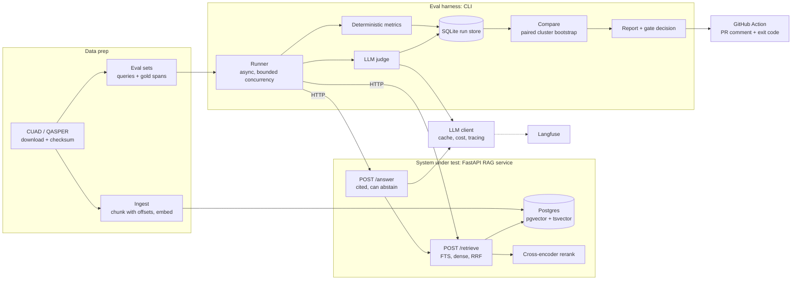

# Calibrated RAG Evaluation Lab: project plan

> Status: draft, 2026-10-13. This is the working plan: scope, design decisions, methodology and schedule. The public README is written in Week 9 from the results this plan produces. Section 15 holds career notes; move it to a private file before the repo goes public.

## 1. Summary

An open-source harness that answers the question every team changing a RAG system has: **did this change make retrieval or answers better, by how much, and can I trust the judge that says so?**

It does three things most RAG demos and most eval libraries don't:

1. **Measures retrieval against span-level ground truth.** "Relevant" means "overlaps the text a lawyer marked" in CUAD, not "the LLM thought so".
2. **Calibrates its LLM judge.** Judge verdicts are compared with gold labels and reported as agreement with confidence intervals (Cohen's κ), along with measured biases (position, verbosity, citation trust). The judge comes with a known error rate.
3. **Gates pull requests on statistically honest comparisons.** The gate uses paired bootstrap confidence intervals, clustered by document, on the metric delta. It ships with a measured false-alarm rate (no-op changes) and measured detection power (seeded regressions).

The system under test is a small but real hybrid-retrieval RAG service: FastAPI, PostgreSQL with pgvector and full-text search, and a cross-encoder reranker. The harness talks to it only over HTTP, so it can evaluate any RAG service that implements the same small contract. That is what makes it a reusable tool rather than a single demo.

## 2. Why this project

**The problem.** Teams change chunking, embedding models, prompts and rerankers without knowing whether quality dropped. When they do measure, they tend to use LLM-as-judge scores that were never validated, compared as point estimates over a few dozen queries. CI gates built on that flake, and flaky gates get ignored or deleted.

**The signal.** Plenty of candidates can build a RAG chatbot. Far fewer can say whether a change made it better, by how much, and with what error bars. That is the senior signal here. The project has to be equally convincing as backend engineering: a typed async service, a real schema with migrations, integration tests against real Postgres, tracing, and a reusable CI component (Section 9).

## 3. Prior art and how this differs

"Why not just use Ragas?" will come up in every interview about this project. Have the answer ready. Before putting any comparison in the README, check each tool's current features; these tools change quickly and the table below is a starting point, not a verified claim.

| Tool or work                              | What it does                                                                                                     | What this project adds                                                                                                         |
| ----------------------------------------- | ---------------------------------------------------------------------------------------------------------------- | ------------------------------------------------------------------------------------------------------------------------------ |
| Ragas                                     | Library of RAG metrics, many of them LLM-judged                                                                  | Judge agreement measured against gold labels and reported with CIs; span-level retrieval ground truth                          |
| DeepEval                                  | pytest-style LLM evals with metric thresholds                                                                    | Gate decisions from paired CIs instead of point-estimate thresholds; a measured false-alarm rate                               |
| promptfoo                                 | Prompt and model comparison, assertions, CI integration                                                          | Same as above, plus retrieval-specific span metrics                                                                            |
| TruLens, Langfuse evals                   | Tracing plus feedback and eval functions                                                                         | Langfuse is used here for tracing; calibration and statistics sit on top                                                       |
| ARES (Saad-Falcon et al., 2023)           | Trains lightweight judges; uses prediction-powered inference (PPI) with a small human-labeled set to produce CIs | Closest in spirit. Read it in Week 1. PPI is a stretch goal here (Section 8.4)                                                 |
| LegalBench-RAG (Pipitone and Alami, 2024) | Legal retrieval benchmark built partly from CUAD, scored with character-level precision and recall               | Closest on data. This project is a tool (gate plus judge calibration), not a benchmark. Reuse its span-metric idea and cite it |

The honest one-line differentiator: **existing tools compute scores; this one tells you how much to trust a score, and whether the difference between two scores is real.**

## 4. Scope

**Goals**

- One command runs a reproducible evaluation over two corpora: CUAD plus one non-legal corpus.
- Four retrieval strategies compared, with confidence intervals.
- Cited answer generation that can abstain ("this contract has no such clause").
- A judge-agreement report: κ against gold, bias test results, and at least one mitigation measured before and after.
- A reusable GitHub Action that posts a results table on a PR and returns pass, fail or inconclusive.
- Two demo PRs: a plausible-looking change with a seeded regression that fails, and a benign change that passes.

**Non-goals.** Say no to these when tempted:

- A chat UI. The interfaces are a CLI, an HTTP API and a PR comment.
- LangChain or LlamaIndex wrappers, or an agent framework. Thin, explicit code reads better in a portfolio and is easier to defend line by line.
- Fine-tuning embedding or reranker models.
- A custom dashboard. Use Langfuse plus a generated HTML report.
- A hosted, multi-tenant eval platform.

## 5. Design decisions to settle in Week 1

The original outline leaves these points implicit, and each one would produce wrong or indefensible numbers if it stayed that way. Each becomes an ADR (Section 12).

### 5.1 Retrieval on CUAD is per contract, not corpus-wide

CUAD questions are asked about one contract: "Highlight the parts (if any) of this contract related to Governing Law". Asked against all 510 contracts at once, that query has roughly 510 correct answers, and recall@5 means nothing. The primary task is therefore **within-document retrieval**: each query carries a `doc_id`, and retrieval is filtered to that contract's chunks. This matches real contract review ("find the termination clause in this agreement").

QASPER questions (Section 10) are also tied to one paper, so both corpora test within-document retrieval. If corpus-wide retrieval matters later, it needs a corpus whose questions are unambiguous across documents, such as Natural Questions.

What this means for pgvector: with a per-document filter, the candidate set is a few hundred chunks. Exact search (a B-tree on `doc_id`, then exact distance) is fast and has perfect recall. An approximate HNSW index combined with a filter can silently return fewer than k results, because the filter is applied to the index's candidate list; pgvector 0.8 added iterative index scans to reduce this. Measure both and record the result in an ADR.

### 5.2 Relevance is span overlap, and chunk sizes are compared at a fixed token budget

Every gold label is a character span in a contract. A retrieved chunk is a hit if it overlaps a gold span. Choose the overlap threshold (any overlap, or at least 50% of the gold span), report which one you chose, and show how sensitive the results are to it.

The trap: **recall@k rewards big chunks.** Five 2,000-token chunks cover more of a contract than five 200-token chunks, so recall@5 alone will "prove" that bigger chunks are better. When comparing chunkers, report recall at a fixed retrieved-token budget, plus character-level precision and recall (the LegalBench-RAG approach). recall@k and MRR remain fine for comparing retrieval strategies over the same chunks.

### 5.3 Offsets survive text normalization

"Span-level ground truth" really means that chunks and gold spans share one character coordinate system. Any cleanup (collapsing whitespace, stripping page headers, fixing hyphenation) shifts offsets. Either chunk the raw text exactly as CUAD labeled it, or keep an offset map from normalized text back to raw text. Enforce it with property-based tests: for every chunk, `doc.text[chunk.start:chunk.end] == chunk.text`, and every gold span's text matches its label.

### 5.4 Unanswerable queries are part of the task

Many (contract, category) pairs in CUAD have no clause. There are 510 × 41 = 20,910 pairs and about 13,000 labels, and one pair can carry several labels, so well over a third of the pairs are empty. Compute the exact share in Week 1.

- Retrieval metrics are computed on answerable queries only; recall is undefined when there is no gold span.
- Answer quality includes **abstention**: on an unanswerable query the correct answer is "not present". Report abstention precision and recall separately, so that a system that always abstains, or never does, scores badly on one of them.

### 5.5 Where the judge's gold labels come from

This is the largest gap in the original outline. CUAD labels say where a clause is. They don't say whether a generated answer is faithful or correct, which is what the judge grades. "Calibrate the judge against CUAD labels" needs a bridge. Use three label sources, from cheapest to most valuable:

1. **Derived labels (free, plentiful).** The CUAD span gives a deterministic check: does the answer's claim about whether the clause is present match gold, and do its citations overlap the gold span? Good for correctness and citations; weak for faithfulness.
2. **Perturbation labels (cheap, controlled).** Take answers known to be good and corrupt them in known ways: cite a different clause, negate a key term ("may" becomes "may not"), add a claim that isn't in the context, point a citation at the wrong chunk. Each perturbation has a known correct verdict. These are also the material for the bias tests.
3. **Human labels (expensive, essential).** Label about 200 to 300 answers yourself against a written rubric, without seeing the judge's verdict. Re-label a sample a few days later to measure your own consistency. This set is the real calibration target; the other two extend it.

The README must say which source each κ comes from. κ against derived labels is partly circular. κ against blind human labels is the headline.

### 5.6 The judge returns binary verdicts per criterion

Use pass or fail per criterion (faithfulness, correctness, citation support) with a short rationale, not a 1 to 10 score. Binary verdicts are more consistent across runs, make κ well defined, and map directly to a gate. Version every judge prompt; its hash is part of the cache key and the run manifest.

### 5.7 There are two sources of noise, and caching hides one of them

- **Query sampling noise.** The eval set is a sample; a different sample gives a different mean. The bootstrap estimates this.
- **Run-to-run noise.** LLM generation and judging aren't deterministic, even at temperature 0 on most hosted APIs. A bootstrap over a single run doesn't see this.

Caching makes identical runs return identical results. With the cache on, "false-alarm rate across repeated identical runs" would be 0% by construction and prove nothing. Gate validation therefore uses two separate studies (Section 8.5): a subsampling study for sampling noise, and A/A reruns with the LLM cache turned off for run-to-run noise.

### 5.8 Two databases, on purpose

Postgres holds the corpus index, which is part of the system under test. SQLite holds run results, which belong to the measuring instrument. Keeping them apart means a run store is a single file that can be uploaded as a CI artifact, downloaded, diffed and queried without a running database, and rebuilding an index never touches past results. Write this down, because a reviewer will ask "why two databases?", and without the reasoning it looks like résumé padding.

### 5.9 Postgres full-text search is not BM25

`ts_rank` and `ts_rank_cd` don't use inverse document frequency the way BM25 does. Either accept that and name the strategy "Postgres FTS" (never "BM25"), or add a BM25 extension such as ParadeDB's `pg_search` as an extra strategy. Start with native FTS and name it accurately.

### 5.10 Gold labels never reach the system under test

Queries and gold spans live with the harness as versioned, hashed files. The RAG service's database contains documents and chunks only. This rules out leakage by design, and the architecture diagram makes it visible.

## 6. Architecture



### Components

- **Corpora and ingest.** Corpus adapters (CUAD, QASPER) produce documents, queries and gold spans. Ingestion is idempotent, keyed on a content hash, so re-ingesting is a no-op. Chunkers are versioned, and each chunk row carries a `chunker_id`, so several chunkings of the same corpus coexist.
- **RAG service.** FastAPI, fully async, with an async Postgres pool.
  - `POST /retrieve {query, doc_id?, strategy, chunker_id, k}` returns chunks with offsets and scores.
  - `POST /answer {query, doc_id?, strategy, chunker_id}` returns the answer, citations (chunk IDs plus offsets), an `abstained` flag, and token usage.
  - `GET /healthz` and `GET /readyz`.
  - Strategy and chunker are chosen per request, so one deployment serves every arm of an experiment.
- **Eval harness.** A CLI: `rageval run | compare | calibrate | report`. The runner is async, with bounded concurrency, retries and resumable runs. It reaches the system under test only through an adapter interface (HTTP by default), which is how another team would plug in their own RAG service.
- **LLM client.** One thin provider interface used by both the generator and the judge, with a content-addressed response cache, token and cost accounting, and Langfuse spans. No framework.
- **Stats.** Bootstrap, κ and the gate decision rule, as pure functions with no I/O, so they are easy to test exhaustively.
- **GitHub Action.** A composite action that runs the harness, compares against a baseline, posts or updates a single PR comment, and sets the exit code.

### Data model sketch

Postgres (corpus, system under test):

```text
documents(id, corpus, external_id, text, sha256, metadata jsonb)
chunks(id, document_id, chunker_id, start_char, end_char, text,
       embedding vector(d), tsv tsvector)
  -- indexes: btree (document_id, chunker_id); GIN (tsv); optional HNSW (embedding)
```

Harness eval sets (versioned JSONL, hash recorded in every run):

```text
query:     {id, corpus, document_id, category, text, split, answerable}
gold_span: {query_id, document_id, start_char, end_char}
```

SQLite run store (measuring instrument):

```text
runs(id, created_at, git_sha, dirty, config_hash, evalset_hash, corpus, split,
     strategy, chunker_id, generator_model, judge_model, judge_prompt_hash, manifest_json)
retrievals(run_id, query_id, rank, chunk_id, start_char, end_char, score)
query_metrics(run_id, query_id, metric, value)       -- long format; paired joins on query_id
answers(run_id, query_id, present, answer, citations_json, latency_ms, cost_usd)
judgments(run_id, query_id, criterion, verdict, rationale, repeat_idx)
```

Keep the LLM cache in its own SQLite file: `llm_cache(key, request_json, response_json, input_tokens, output_tokens, created_at)`.

## 7. Retrieval strategies

Hold the chunker fixed while comparing strategies, and vary the chunker in a separate experiment. A full strategy × chunker × k grid is expensive and hard to read.

| ID  | Strategy                                                     | Notes                                                                                                                                                       |
| --- | ------------------------------------------------------------ | ----------------------------------------------------------------------------------------------------------------------------------------------------------- |
| S1  | Lexical: Postgres FTS (`websearch_to_tsquery`, `ts_rank_cd`) | A strong baseline on legal text, where exact terms ("indemnify", "governing law") matter. Dense-only retrieval can lose to it, so it has to be in the table |
| S2  | Dense: pgvector cosine distance with a local embedding model | Exact search under the per-document filter (Section 5.1)                                                                                                    |
| S3  | Hybrid: S1 + S2 combined with Reciprocal Rank Fusion         | RRF needs no score normalization and has one parameter. Weighted score fusion is an optional ablation                                                       |
| S4  | S3 + cross-encoder rerank of the top N                       | Report the latency cost next to the quality gain                                                                                                            |

Chunkers: **C1** fixed-size token windows with overlap; **C2** structure-aware (split on section and clause headings and numbering, falling back to C1 for long sections). Optional **C3**: sentence windows.

Use a local embedding model and a local cross-encoder, so retrieval evals are free, effectively deterministic, and run in CI with no API keys. Hosted embeddings or rerankers can be added later as extra strategies.

## 8. Evaluation methodology

### 8.1 Splits

CUAD's SQuAD-style release ships a test split; the Hugging Face loader reports 4,182 test rows, which works out to 102 contracts × 41 categories (confirm on load). Carve a dev set out of train. Tune chunk size, RRF parameters, rerank depth and prompts on dev only, and report test numbers once per final configuration. Tuning on the reporting set is the most common way eval numbers lie, and a careful reviewer will look for it.

The **CI subset** is a fixed, stratified sample of dev contracts used for PR gating, so CI stays fast and cheap. Its size comes from the power study in Section 8.5, not a guess.

### 8.2 Retrieval metrics

For an answerable query with gold spans and a ranked list of retrieved chunks:

- **Hit@k:** 1 if any of the top k chunks overlaps any gold span.
- **Recall@k:** the fraction of the query's gold spans overlapped by at least one top-k chunk.
- **MRR@k:** 1 / (rank of the first chunk overlapping a gold span), or 0 if none is in the top k.
- **Character precision and recall at budget B:** within the first B retrieved tokens, the share of retrieved characters inside gold spans (precision) and the share of gold characters retrieved (recall).
- Optional: nDCG@k.

All metrics are averaged per query, then over queries. Unit-test each one against hand-computed fixtures, including the edge cases: no gold spans, duplicate chunks, overlapping gold spans, and a gold span split across two chunks.

### 8.3 Answers and answer metrics

The generator receives the retrieved chunks with their IDs and must return structured output, validated by Pydantic: `{present: bool, answer: str, citations: [chunk_id]}`. Citations map back to character offsets, so they can be checked against gold without an LLM.

- **Deterministic metrics (no judge):** presence accuracy, abstention precision and recall, citation precision (cited chunks that overlap gold, divided by cited chunks), and citation recall.
- **Judge metrics:** faithfulness (every claim is supported by the cited chunks) and correctness (the answer matches the gold clause's content), each pass or fail.

### 8.4 Judge calibration

**Protocol**

1. Freeze the judge prompt (version and hash) and the model snapshot.
2. Assemble the labeled set from Section 5.5: about 200 to 300 blind human labels, plus derived and perturbation labels.
3. Run the judge with the cache off, three times, to measure the judge's own run-to-run consistency.
4. Report, for each criterion and each label source:
   - Cohen's κ with a bootstrap 95% CI, never a bare point estimate.
   - Raw agreement and the confusion matrix. The dangerous cell is "judge says pass, gold says fail", because those are regressions the gate will never see.
   - The judge's precision and recall on the "fail" class.
   - Class prevalence. κ drops when one class dominates (the "kappa paradox"), so a high-agreement, low-κ result on a 90/10 split needs the confusion matrix beside it. Gwet's AC1 is a useful secondary statistic.
5. Sanity-check the sample size. With balanced classes and about 85% agreement, n ≈ 200 gives a 95% CI for κ of roughly ±0.1. Recompute it for your actual prevalence before labeling more.

**Bias tests.** Each one is a paired experiment with a CI on the effect.

| Bias            | Test                                                                                                                | Reported as                                                                             |
| --------------- | ------------------------------------------------------------------------------------------------------------------- | --------------------------------------------------------------------------------------- |
| Position        | Pairwise judge ("which answer is better?") run in both orders, A/B and B/A                                          | Flip rate: share of pairs where the verdict follows the position rather than the answer |
| Verbosity       | Pad answers with true but irrelevant contract text, or restate them at greater length, without changing correctness | Change in pass rate on items whose gold verdict didn't change                           |
| Citation trust  | Keep the answer text, swap its citations for plausible but wrong chunks                                             | Share of corrupted answers the judge still passes on faithfulness                       |
| Self-preference | Grade the same answers with a judge from the generator's model family and one from a different family               | Difference in pass rate on identical items                                              |

Test mitigations instead of only reporting biases: evaluate both orders and require consistency, cap answer length, show the judge only the cited text, use a different model family for judge and generator. Show before-and-after numbers for at least one mitigation. That is the part that reads as engineering rather than reporting.

**Stretch goal: prediction-powered inference (PPI)**, as in ARES. Use the human-labeled set to estimate the judge's error, then correct the judge-scored metric on the large unlabeled set, producing a CI that accounts for judge error. That turns "the judge agrees with humans at κ = 0.7" into "the true faithfulness rate is X ± Y", which is the number a team actually needs.

### 8.5 The CI gate

**Comparison.** Run the candidate and the baseline on the same queries, compute the per-query difference in the primary metric, and bootstrap its mean.

- **Paired.** Resample the same items in both runs. This gives much tighter intervals than comparing two independent means.
- **Clustered by document.** Queries about the same contract are correlated, since they share chunking quirks and formatting. Resample contracts, and include every query of each sampled contract. Resampling individual queries understates the variance and inflates false alarms. The subsampling study below measures exactly how much, which makes a strong interview story.
- 10,000 resamples, percentile intervals (BCa optional), with the RNG seed recorded in the report.

**Decision rule.** Let δ be the smallest regression worth blocking (for example, 2 points of recall@5), and let [lo, hi] be the 95% CI of candidate minus baseline.

| Outcome      | Condition          | Meaning                                                                                                          |
| ------------ | ------------------ | ---------------------------------------------------------------------------------------------------------------- |
| Pass         | lo ≥ −δ            | Any regression is smaller than δ, with 95% confidence. If hi < 0 as well, add a "small regression detected" note |
| Fail         | hi < 0 and lo < −δ | Confidently worse, and a regression of δ or more can't be ruled out                                              |
| Inconclusive | lo < −δ and hi ≥ 0 | The eval set is too small to tell. The check gets a neutral status and suggests a full dev-set run               |

Under a true null, Fail requires the upper bound below zero, so the nominal false-fail rate is about 2.5%. The studies below check whether that holds in practice. A high Inconclusive rate on no-op changes means the CI subset is too small for the chosen δ.

**One primary metric.** Gate on one primary metric per kind of change: recall@5 for retrieval changes, judge faithfulness pass rate for prompt or generator changes. Report everything else as secondary, non-gating information. With eight metrics each at a 2.5% false-fail rate, about 18% of no-op PRs would fail on something if the metrics were independent (they're correlated, so somewhat less, but still far above 2.5%). If several metrics must gate, apply Holm-Bonferroni.

**Validating the gate.** These produce headline numbers.

1. **Subsampling study (retrieval; cheap, no LLM calls).** Treat the full dev set as the population. Run each configuration once over all of dev, then draw 1,000 random CI-sized subsets of contracts and apply the gate to each, using only stored results.
   - _False-alarm rate:_ for two configurations whose full-dev delta is about zero, the share of subsets that Fail. Run it with both query-level and contract-level resampling to show that only the clustered version holds its nominal rate.
   - _Power:_ seed regressions of known size Δ (for example, remove the relevant chunks from the top k on a random p% of queries), and measure the share of subsets that Fail. Plotting power against Δ gives the **minimum detectable effect** for the CI subset size.
   - _Coverage:_ a unit test on synthetic data with a known true difference, checking that about 95% of the intervals contain it.
2. **A/A reruns (LLM stages; costs money).** Run 10 to 20 repeats of the same configuration on the CI subset with the LLM cache off, and apply the gate to pairs of repeats. If the false-fail rate is above nominal, run-to-run variance has to be built into the gate, for example by averaging k repeats per run or adding a variance component.

**Baseline management.** For retrieval metrics, recompute the baseline at the merge-base commit in the same job: it's cheap and immune to drift. For LLM metrics, reuse the stored baseline run from `main` and print its age in the report, because hosted models can change underneath you. Record the choice in an ADR.

**Fork PRs.** Workflows triggered by pull requests from forks don't receive repository secrets. The LLM stages must skip cleanly and fall back to a retrieval-only gate instead of failing. Don't use `pull_request_target` to run untrusted PR code with secrets; it is a well-known security hole.

**PR comment.** One sticky comment, updated on each push: baseline, candidate, delta, 95% CI and outcome for each metric, the cost of the run, and links to the full report artifact and the Langfuse traces.

### 8.6 Reproducibility, cost and latency

**Run manifest**, recorded for every run: git SHA and dirty flag, config hash, eval-set hash, chunker ID, model IDs (dated snapshots, never moving aliases), prompt hashes, a hash of `uv.lock`, RNG seeds, and the hardware used for latency numbers.

**Cache.** The key is a hash of provider, model snapshot, prompt template hash, rendered input and parameters. Three modes: `read-write` (local development), `read-only` (CI baselines), and `off` (A/A reruns and judge-consistency runs).

**Cost.** Tokens × prices from a versioned price file that carries a date, since prices change. The report gives cost per run and per query, and a `--max-cost` guard estimates spend up front and aborts if it would exceed the limit.

**Latency.** p50, p95 and p99 for `/retrieve` (per strategy) and `/answer`, measured with a load generator (k6 or Locust) at fixed concurrency against the Docker Compose stack, cold and warm, on stated hardware. Report retrieval latency (your code) separately from end-to-end answer latency (dominated by the LLM provider), and give reranking's latency cost explicitly.

**Targets.** Set these now and report actual values later. These are budgets, not promises.

- CI subset run: under 10 minutes, under $\_\_\_.
- Full CUAD test run: cold cache under $\_\_\_; warm cache close to $0.

**Tracing.** One Langfuse trace per query, with spans for retrieve (strategy, k, latency), rerank, generate (tokens, cost) and judge (verdict). Langfuse's self-hosted stack is several services (in v3: Postgres, ClickHouse, Redis and object storage; check the current docs), which conflicts with a lightweight one-command setup. Make tracing optional, behind a Compose profile or an environment variable pointing at a Langfuse instance.

## 9. Backend engineering quality bar

The "senior backend" half of the positioning rests on this section, and the original outline barely covers it. Reviewers skim the code, and these are what they look for:

- **Typing.** Pydantic v2 models at every boundary (API, config, LLM structured output), and pyright or mypy in strict mode in CI.
- **Database.** Alembic migrations (no `create_all` at startup), an async connection pool, explicit indexes backed by `EXPLAIN ANALYZE` evidence in an ADR, idempotent ingestion keyed on content hash, and bulk loading (`COPY`) for chunks and embeddings.
- **API.** Typed request and response models, a consistent error format (RFC 9457 problem details), timeouts and cancellation on outbound calls, health and readiness endpoints, and OpenAPI docs that match reality.
- **Resilience.** Retries with exponential backoff and jitter on 429 and 5xx responses, bounded concurrency, and runs that resume after a crash (writes are idempotent per run ID and query ID) instead of starting over.
- **Configuration.** One `pydantic-settings` config for the environment; experiment configs as versioned YAML whose hash identifies the experiment.
- **Boundaries.** An import-linter rule that stops the harness from importing service internals, so the HTTP contract stays the only coupling.
- **Testing.**
  - Unit: metrics, κ and the bootstrap against hand-computed fixtures, plus the bootstrap coverage test from Section 8.5.
  - Property-based (Hypothesis): chunk offset invariants (Section 5.3) and RRF invariants (ties, permutations, duplicates).
  - Integration: Postgres with pgvector via testcontainers; the FastAPI app via an `httpx` async client.
  - Contract: the adapter interface tested against a fake system under test.
  - LLM calls replayed from recorded fixtures; no network access in unit tests.
- **Tooling.** uv with a committed lockfile, ruff for lint and format, pre-commit, and GitHub Actions running lint, type checks and tests on every PR. Docker Compose plus a Makefile: `make up`, `make data`, `make ingest`, `make eval`.
- **Logging.** Structured JSON logs carrying `run_id` and `query_id`.

## 10. Data

### CUAD

- 510 commercial contracts from SEC EDGAR filings, 41 clause categories, more than 13,000 expert labels, licensed CC BY 4.0. Attribution is required: credit The Atticus Project and link the license in the README and in any derived data you publish (including `evalsets/`).
- The SQuAD-style JSON gives character offsets (`answer_start`) into each contract's text. That is what makes span-level ground truth possible.
- The text is messy: it was extracted from filings, with page artifacts and inconsistent headings. The structure-aware chunker has to cope, and C1 is the fallback.
- The questions are templated (one template per category). Threat to validity: lexical search may benefit from category names that appear in the template. Ablation: LLM-paraphrased queries, spot-checked by hand, to see whether the ranking of strategies holds.
- Don't commit the raw dataset. `make data` downloads it and verifies a checksum.
- The repo's code is MIT-licensed and the data is CC BY 4.0. Say so explicitly in a `DATA_LICENSES.md`.

### Second corpus: proving the tool is domain-agnostic

**Recommendation: QASPER** (AllenAI). It has 5,049 questions over 1,585 NLP research papers, with answers and supporting evidence annotated by NLP practitioners, and its Hugging Face card lists it as CC BY 4.0. Its shape matches CUAD (long documents, evidence annotations, some unanswerable questions), so it exercises the same span machinery in a different domain. Its questions were written by people who had read only the title and abstract, so they are natural rather than templated and less lexically aligned with the answer text. Evidence is given as paragraph text rather than character offsets, so you'll need an adapter that locates evidence in the full text. That adapter is good proof that the corpus interface is real.

Alternatives, with license notes:

- **SQuAD 2.0** (CC BY-SA 4.0): the same format as CUAD, but short Wikipedia paragraphs make retrieval too easy to be interesting. ShareAlike applies to derived data you publish.
- **Natural Questions** (CC BY-SA 3.0): the right choice if you later add corpus-wide retrieval.
- **HotpotQA** (CC BY-SA 4.0): multi-hop questions, which is a different problem.
- **Avoid MS MARCO** here: its terms limit use to non-commercial research.

Check every license against its primary source before publishing, and record the result in `DATA_LICENSES.md`.

## 11. Schedule

This version makes two changes to the original outline:

1. **A retrieval-only gate moves up to Week 4.** The gate is the headline feature, and retrieval metrics are cheap and deterministic. Building it early means the most distinctive piece can't get squeezed at the end, and a credible project exists even if Weeks 7 to 9 slip.
2. **Every phase has an exit criterion**, so "done" is checkable.

The nine weeks assume roughly 20 focused hours a week. At 10 hours a week, plan on 14 to 16 weeks, or apply the cut list.

| Week | Focus                                                                                                                                                                                                                                | Deliverable                                                                       | Exit criterion                                                                         |
| ---- | ------------------------------------------------------------------------------------------------------------------------------------------------------------------------------------------------------------------------------------ | --------------------------------------------------------------------------------- | -------------------------------------------------------------------------------------- |
| 1    | Read ARES, LegalBench-RAG and the Ragas docs. Write the eval spec (the Section 5 decisions, metric definitions, the gate rule). Repo skeleton: uv, ruff, pyright, pre-commit, CI, Docker Compose with Postgres and pgvector, Alembic | `docs/eval-spec.md`, first ADRs, CI green on an empty app                         | `make up` works from a clean clone                                                     |
| 2    | CUAD loader with offsets, gold spans and splits; chunker C1; local embeddings; dense retrieval (S2); retrieval metrics with tests                                                                                                    | Baseline recall@5 and MRR on dev for S2                                           | Offset property tests and metric fixture tests pass; one command reproduces the number |
| 3    | FTS (S1), RRF hybrid (S3), cross-encoder rerank (S4); chunker C2; SQLite run store; `rageval run`                                                                                                                                    | Stored runs for S1 to S4                                                          | The same config run twice gives identical retrieval results                            |
| 4    | Paired cluster bootstrap; `rageval compare`; subsampling study for retrieval; retrieval-only GitHub Action                                                                                                                           | Strategy comparison table with CIs; first power curve; the Action running on a PR | Bootstrap coverage test passes; clustered false-alarm rate is close to nominal         |
| 5    | Cited answers with structured output and abstention; LLM client with cache and cost accounting; deterministic answer metrics; Langfuse tracing                                                                                       | Answer metrics on dev                                                             | Cost per run is reported; a warm-cache rerun costs about $0                            |
| 6    | Judge prompts (binary, per criterion); perturbation set; 200 to 300 blind human labels against a written rubric                                                                                                                      | Labeled calibration set; judge v1                                                 | Labels were made blind; the rubric is in the repo                                      |
| 7    | Calibration report: κ with CIs, confusion matrices, bias tests, one mitigation before and after; LLM A/A reruns                                                                                                                      | Judge-agreement report                                                            | Every number in the report regenerates from one command                                |
| 8    | Extend the gate to judge metrics; sticky PR comment; fork-PR handling; the two demo PRs; latency load test                                                                                                                           | Two demo PRs; latency table                                                       | Both demo PRs behave as expected on a fresh fork                                       |
| 9    | QASPER adapter and results; README with architecture diagram, results table and 90-second demo; remaining ADRs                                                                                                                       | Public v0.1 release                                                               | Someone else can reproduce the headline table from the README alone                    |

**Demo PR idea.** Make the seeded regression realistic rather than obviously broken. For example, a tidy-looking refactor that switches the FTS text-search config from `english` to `simple`, which quietly disables stemming. A gate that catches a change a human reviewer would approve is the whole point.

**Cut list.** If behind schedule, cut from the top:

1. The optional AWS deployment. An eval harness doesn't need a public deployment to be credible; a reproducible Compose stack is enough.
2. The self-preference bias test and the PPI stretch goal.
3. Chunker C3, the weighted-fusion ablation and the paraphrased-query ablation.
4. QASPER scope: shrink to a subset, but keep it, because it backs the domain-agnostic claim.

**Never cut:** the blind human labels, the clustered bootstrap, the false-alarm and power measurements, and the demo PRs. Those are the project.

## 12. Architecture decision records

Use a short format (context, decision, alternatives, consequences) in `docs/adr/`. Write each ADR at the moment you make the decision, not in Week 9; ADRs written after the fact read as rationalization. Feature the five most interesting in the README and keep the rest short.

1. Postgres with pgvector rather than a dedicated vector database.
2. Exact search under per-document filters versus HNSW, with measurements.
3. A separate SQLite run store next to the Postgres corpus store.
4. Span-overlap relevance and token-budget metrics rather than chunk-ID relevance.
5. Gold labels live in the harness and never in the system under test.
6. Binary per-criterion judge verdicts rather than numeric scales.
7. Paired, document-clustered bootstrap and the three-outcome gate rule.
8. The caching and determinism strategy (cache modes, and what A/A runs bypass).
9. Postgres FTS naming and the BM25 question.
10. Baseline management in CI: recompute at the merge base versus a stored artifact.

## 13. Repository layout

```text
calibrated-RAG-evaluation-lab/
├── src/rageval/
│   ├── corpora/      # CUAD and QASPER adapters: documents, queries, gold spans
│   ├── ingest/       # versioned chunkers, embedding, bulk load into Postgres
│   ├── service/      # FastAPI app: /retrieve, /answer, strategies, reranker
│   ├── llm/          # provider interface, cache, cost accounting, tracing
│   ├── harness/      # runner, adapters for the system under test, metrics, judge, run store
│   ├── stats/        # bootstrap, kappa, gate decision (pure functions)
│   └── report/       # Markdown and HTML reports, PR comment rendering
├── migrations/       # Alembic
├── evalsets/         # generated query and gold-span files (hashed, CC BY attribution)
├── configs/          # experiment YAMLs
├── action/           # reusable GitHub Action (action.yml)
├── tests/{unit,property,integration}/
├── docs/{project-plan.md,eval-spec.md,adr/}
├── docker-compose.yml
├── Makefile
├── pyproject.toml
└── uv.lock
```

`rageval` is a placeholder; check whether the name is free on PyPI before publishing anything.

## 14. Results to publish

Every number in the README links to the command that regenerates it. A number that the repo can't reproduce doesn't go in the README, a résumé or a pitch.

| Result                                                                                                   | Produced by                      | Value |
| -------------------------------------------------------------------------------------------------------- | -------------------------------- | ----- |
| recall@5 and MRR per strategy (S1 to S4), with 95% CIs, CUAD test                                        | `rageval run`, `rageval compare` | TBD   |
| Character precision and recall at a token budget, per chunker                                            | `rageval run`                    | TBD   |
| Presence accuracy, abstention precision and recall, citation precision                                   | `rageval run`                    | TBD   |
| Judge κ against blind human labels, per criterion, with 95% CIs                                          | `rageval calibrate`              | TBD   |
| Bias effects (position flip rate, verbosity shift, citation trust), plus one mitigation before and after | `rageval calibrate`              | TBD   |
| Gate false-alarm rate: retrieval (subsampling) and LLM stages (A/A)                                      | gate validation study            | TBD   |
| Minimum detectable recall@5 drop at 80% power on the CI subset                                           | gate validation study            | TBD   |
| Cost per full run (cold and warm cache) and per CI run                                                   | run manifests                    | TBD   |
| p95 latency: retrieval per strategy, end-to-end answer                                                   | load test                        | TBD   |
| The headline table repeated on QASPER                                                                    | `rageval run --corpus qasper`    | TBD   |

## 15. Positioning (career notes, keep out of the public repo)

**Motivation.** In the job-postings dataset this project was scoped from, evals appear in 65% of AI-engineer postings and RAG in 62%. Keep that statistic out of the README, since it refers to a private dataset.

**The pitch, revised.** The original is one long sentence listing seven technologies. In conversation, lead with the problem and the numbers, and give the stack when asked:

> "I built an open-source harness that tells a team whether a RAG change actually made things better. Its LLM judge is calibrated against blind human labels, at κ = **, and its CI gate catches a **-point recall drop **% of the time while failing no-op changes only **% of the time. On 510 legal contracts it showed that hybrid retrieval with reranking beats dense-only by ** points of recall@5, at a cost of ** ms of p95 latency."

Stack line for the résumé: Python (FastAPI, Pydantic, asyncio), PostgreSQL (pgvector, full-text search), SQLite, Langfuse, GitHub Actions, Docker, testcontainers.

Keep two kinds of claim apart. "Hybrid beats dense by X" is a finding the tool produced. "The gate catches a Δ regression with P% power at an F% false-alarm rate" is a property of the tool. The second is the stronger claim, because few other candidates can make it.

**Résumé bullet templates.** Fill in measured numbers only.

- Built an open-source RAG evaluation harness with span-level ground truth over 510 legal contracts; compared four retrieval strategies with paired bootstrap CIs and found hybrid retrieval with reranking improved recall@5 by ** points (95% CI ** to \_\_) over dense-only.
- Calibrated an LLM judge against ** blind human labels (Cohen's κ = **); measured and mitigated position and verbosity bias, reducing the order-flip rate from **% to **%.
- Shipped a reusable GitHub Action that gates PRs on document-clustered bootstrap CIs, validated at a **% false-alarm rate and **% power for **-point regressions, at $** per CI run.

**Interview talking points**, each a trade-off you'll have measured:

- Why the bootstrap is clustered by document, and what happens to the false-alarm rate when it isn't.
- Why recall@k misleads when comparing chunk sizes.
- Why κ can be low when raw agreement is high.
- Why caching makes A/A tests meaningless unless you bypass it.
- Why gold labels never touch the system under test.
- Why a three-outcome gate beats pass/fail when the eval set is small.
- What changes at 100 times the corpus size: approximate search with iterative scans, partitioning, batch embedding jobs, and queue-based workers for eval runs.

## 16. Risks

| Risk                                                      | Mitigation                                                                                                                   |
| --------------------------------------------------------- | ---------------------------------------------------------------------------------------------------------------------------- |
| Scope overrun; nine weeks is tight for all of this        | Retrieval gate by Week 4, so a credible project exists even if later weeks slip; cut list in Section 11                      |
| Human labeling takes longer than planned, or gets skipped | Budget it in Week 6: at 1 to 2 minutes per item, 300 items is 5 to 10 hours. It is on the never-cut list                     |
| LLM costs creep (A/A reruns, bias tests)                  | `--max-cost` guard, a cheap judge model during development, a CI subset sized by the power study                             |
| The provider changes a model underneath you               | Pin dated model snapshots, record them in the manifest, and report baseline age                                              |
| CUAD's text artifacts break structure-aware chunking      | C1 is the fallback; report C2 only where it helps                                                                            |
| The results are dull, e.g. every strategy ties            | That is a legitimate finding if the CIs are tight; a tool that says "no real difference" is doing its job. Report it as such |
| Self-hosted Langfuse is heavy for a one-command setup     | Tracing is optional, behind a Compose profile or an environment variable                                                     |

## 17. Open questions

1. **LLM provider and budget.** Which provider or providers for the generator and the judge, and how much total spend is acceptable? The A/A reruns and bias tests are the expensive parts. Two different model families, one for the judge and one for the generator, are needed for the self-preference test.
2. **Hours per week.** The schedule assumes about 20. Adjust it, or apply the cut list.
3. **Public from day one, or at v0.1?** Going public early shows process (issues, PRs, ADRs written as decisions are made); going public later avoids a half-finished first impression. I lean toward public early with a clear "work in progress" status, since the demo PRs have to live in the repo anyway.
4. **Second corpus.** QASPER is the recommendation. Confirm it, or choose another and check its license.
5. **Package name.** Replace the `rageval` placeholder after checking PyPI.
